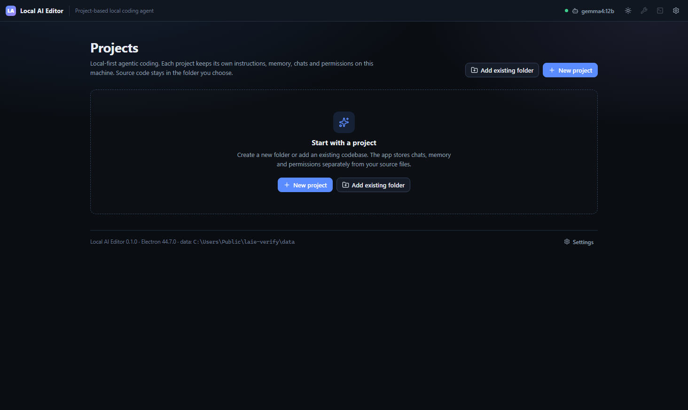

# Local AI Editor

A local-first, project-based AI coding desktop application. It combines a project
dashboard, an agent chat, a Monaco editor, a real file explorer, an integrated
terminal, project memory and a permission-gated tool runtime — all running on
your machine against a local model served by [Ollama](https://ollama.com).

Nothing is sent to a cloud service. Application data lives in its own folder,
separate from your source code, and can be moved, backed up and restored from the
UI.



## Features

- **Multiple projects**, each with its own workspace path, instructions, memory,
  chats, plans, permissions and task history.
- **ChatGPT-style agent** with streaming output, live tool cards, diffs, plan
  approval and honest failure/cancellation states.
- **Plan mode / Build mode**: Plan mode is read-only and produces a persistent,
  structured plan; Build mode implements one verifiable task at a time and
  requires recorded evidence before a task can be marked complete.
- **Real tool execution**: filesystem, ripgrep-style search, terminal commands,
  test/lint/build/typecheck, read-only Git, project memory and planning tools.
- **Permission prompts** with *Allow Once* and project-scoped *Always Allow*;
  permissions can be reviewed and revoked, and never override path checks.
- **Integrated terminal** (xterm.js + backend process manager) with streaming
  output, exit codes, cancellation and timeouts.
- **Editor**: Monaco, tabs, dirty indicators, save, external-change detection,
  before/after diff viewer for agent edits.
- **Local models**: real Ollama model discovery, capability reporting, pull with
  progress, connection test and generation settings.
- **Durable storage**: atomic JSON writes, `.bak` recovery, corrupt-file
  quarantine, JSON schema validation, migrations, verified backups and safe data
  relocation.
- **Five-minute context cache** with dependency fingerprints and diagnostics.
- **Security**: Electron context isolation, sandboxed renderer, no Node
  integration, validated IPC, workspace path/symlink checks, CSP, external-link
  and download blocking.

## Requirements

- Node.js 20+ (developed on Node 24)
- npm
- Git (optional, for project status/diff tools)
- Ollama running locally (default `http://127.0.0.1:11434`) with at least one
  model installed. A model that supports tool calling is strongly recommended.

## Install and run (production build)

```bash
npm install
npm run build
npm start
```

`npm install` downloads the Electron binary. On a normal desktop this works
out of the box; if lifecycle scripts are blocked in your environment, run
`node node_modules/electron/install.js` once after installing dependencies.

## Development

```bash
npm run dev
```

This starts the Vite dev server on port 5199, watches the Electron main/preload
bundles, launches Electron and restarts it when main/preload code changes.
Renderer changes hot-reload.

Other useful scripts:

```bash
npm run typecheck   # strict TypeScript, no emit
npm test            # unit + integration + security tests (Vitest)
npm run test:e2e    # Playwright desktop E2E (editor, terminal, model, backup, restart)
npm run test:e2e:permissions  # permission workflow E2E (uses a test-mode plan seed)
npm run verify      # checks production build artifacts
npm run check:env   # Node, Git, Electron, Ollama and build diagnostics
```

## Build a desktop installer

```bash
npm run package   # unpacked app in release/
npm run dist      # NSIS installer + portable exe (Windows); dmg/AppImage on other OSes
```

Configuration lives in the `build` section of `package.json`. Icons are in
`build/icon.png` and `build/icon.ico`.

## Connect Ollama and choose a model

1. Start Ollama (`ollama serve`, or launch the Ollama desktop app).
2. Install a model, e.g. `ollama pull gemma4:12b` or `ollama pull qwen3:8b`.
   Use a model with the `tools` capability for agentic work.
3. In the app, click the model chip in the title bar (or **Settings → General →
   Change model**).
4. Refresh the list, select a model, and use **Test** to send a real request.
5. Optionally set a per-project override in **Project Settings → Model override**.

The app lists only models reported by Ollama. It never invents installed models,
and it warns when a model does not report tool support. Tool support is read from
Ollama's capability metadata.

Generation settings (temperature, top-p, `num_ctx`) are configurable. Larger
contexts consume more memory; on 16 GB machines a 12B model plus Electron can be
tight. If your compositor crashes in a VM, set `LAIE_DISABLE_GPU=1`.

## Application data

Default location:

- Windows: `%USERPROFILE%\Documents\LocalAIEditorData`
- macOS/Linux: `~/Documents/LocalAIEditorData`

The active location is recorded in Electron's userData
(`storage-location.json`). **Settings → Data & Storage** shows the path, size and
free space, and can create/restore/export backups or move the data folder.

```
LocalAIEditorData/
├── manifest.json
├── app/
│   ├── settings.json
│   ├── storage-version.json
│   └── custom-tools.json
├── projects/project-<id>/
│   ├── project.json
│   ├── instructions.md
│   ├── memory.md
│   ├── memory-history/
│   ├── chats/chat-<id>/{chat.json,messages.jsonl,session.json}
│   ├── plans/plan-<id>.json
│   ├── tasks/task-<id>.json
│   ├── permissions.json
│   └── logs/executions.jsonl
├── backups/
├── logs/app.log
└── cache/
```

Source code is **never copied** into application storage. Moving data copies and
verifies the data folder, switches the pointer only after verification, and
leaves the original in place. Local model files and project folders are not
included in backups — see [docs/storage.md](docs/storage.md).

Optional environment overrides (all optional, see `.env.example`):
`LAIE_USER_DATA_DIR`, `LAIE_DATA_DIR`, `LAIE_DISABLE_GPU`, `LAIE_TEST_MODE`.

## Permissions

- Read-only tools (`list_files`, `read_file`, `grep_search`, `git_status`, …) are
  auto-approved when the project policy allows it.
- File writes inside the workspace are auto-approved by default; deletes always
  ask and cannot be stored as “always”.
- Shell commands always ask unless a project-scoped permission exists for that
  exact command, or the command is a recognised read-only inspection command.
- **Allow Once** applies to that tool call only.
- **Always Allow** stores a narrow, project-scoped permission that can be revoked
  in **Tools & Permissions → Permissions**.
- Hard-blocked commands (disk formatting, disk partitioning, shutdown, boot
  configuration, drive-root deletion) cannot be approved from chat.
- Unanswered prompts fail closed (denied) after the configured timeout.

A stored permission never bypasses workspace path validation. See
[docs/permissions.md](docs/permissions.md).

## Plan and Build mode

- **Plan** inspects read-only tools, then saves a structured plan via `save_plan`.
  It cannot write project files, install packages or run mutating commands.
- Approve the plan in the plan panel. **Approve & switch to Build** also changes
  the chat mode.
- **Build** loads the approved plan, executes tasks in order, and requires
  evidence (a real command result or verification) before a task can be marked
  completed. Tasks cannot be completed before earlier tasks.
- Build Mode refuses to start while an unapproved draft plan exists, and it blocks
  mutating tools until an approved or internal plan exists.
- A workspace-level lock prevents two runs from modifying the same project at
  once.
- Plans and task history are preserved after execution.

## Agent tools

Filesystem: `list_files`, `read_file`, `read_multiple_files`, `create_file`,
`write_file`, `edit_file`, `rename_file`, `delete_file`, `create_directory`,
`search_files`, `get_file_info`.

Search: `grep_search`, `find_symbol`, `find_references`, `get_diagnostics`
(textual search; `get_diagnostics` uses the project's typechecker when available).

Terminal: `run_command`, `get_command_output`, `stop_command`,
`check_environment`.

Verification: `run_tests`, `run_linter`, `run_build`, `run_typecheck` — these
detect package scripts and never claim a missing script passed.

Git (read-only): `git_status`, `git_diff`, `git_log`, `git_branch_info`.

Project/planning: `get_project_info`, `read_project_instructions`,
`read_project_memory`, `update_project_memory`, `list_project_chats`,
`save_plan`, `update_task_status`, `get_task_status`.

Custom tools are declarative command templates with named parameters. They are
validated, require explicit approval before use, always ask for permission, and
cannot run arbitrary JavaScript. See **Tools & Permissions → Custom tools**.

## Keyboard shortcuts

| Shortcut | Action |
| --- | --- |
| `Ctrl/Cmd + J` | Toggle terminal |
| `Ctrl/Cmd + S` | Save current file |
| `Ctrl/Cmd + P` | Quick open file |
| `Ctrl/Cmd + N` | New chat (new project on the dashboard) |
| `Ctrl/Cmd + ,` | Settings |
| `Escape` | Close the top dialog / deny a permission prompt |

Shortcuts are handled by the renderer; the native menu displays the same
accelerators without double-registering them.

## Security model and limitations

- Renderer: `contextIsolation: true`, `nodeIntegration: false`,
  `sandbox: true`, strict CSP, no webviews, navigation and downloads blocked.
- IPC: every channel is explicitly defined and every payload is validated with
  Zod; only the main window's top frame is accepted.
- Files: every path is workspace-relative, lexically contained, and checked
  against symlink real paths. Files outside the workspace are rejected.
- Shell commands are **not** a sandbox. A command can intentionally or
  indirectly access anything your user account can. The approval prompt, command
  risk classification and hard-block list are the real boundary; path checks
  alone cannot contain a shell. Treat approved commands as you would commands you
  type yourself.
- Data is stored unencrypted in your user profile. Use OS disk encryption if
  needed.
- The terminal is a command runner with an xterm.js front end, not a full PTY;
  interactive TUI programs are not supported.
- No cloud provider, embeddings, vision input or web browsing is implemented.

## Testing and verification status

Last verified in this environment (Windows 11, Electron 44.7.0, Ollama 0.40.8,
models `gemma4:12b` and `qwen3.8:27b`):

- `npm run typecheck`: **pass** (strict, no errors).
- `npm test`: **36 tests pass** across unit, integration and security suites.
- Production build: **pass** (main 1.1 MB, preload 7.4 KB, renderer ~14.5 MB — the
  renderer is large because Monaco workers are bundled inline for offline
  `file://` use).
- GUI E2E (Playwright): **pass** for project creation, Monaco edit + `Ctrl+S`
  save, terminal command execution, real local-model chat (`gemma4:12b` returned
  “pong”), verified backup creation and restart persistence.
- Permission E2E: **pass** for the approval dialog, Allow Once (not persisted),
  Always Allow (project-scoped, reused without a prompt), and real command output
  (`42`).
- Unpacked packaging (`electron-builder --dir`): **pass**; the packaged
  `Local AI Editor.exe` launched, loaded the renderer and shut down cleanly in
  smoke mode. Installer creation/installation was not exercised.
- Plan Mode structured plan creation and approval were verified with the real
  model (screenshot `docs/screenshots/plan.png`). Model compliance with planning
  instructions varies; the deterministic permission E2E seeds an approved plan
  through a test-only IPC hook (`LAIE_TEST_MODE=1`).

Screenshots from the runs are in `test-results/`. Tests and caveats are described
in [docs/testing.md](docs/testing.md).

## Project structure

```
electron/            Electron main, preload, shared IPC contracts
src/backend/         Storage, services, agent runtime, tools, permissions, providers
src/renderer/        React UI (store, features, styles)
tests/               unit, integration, security, e2e
scripts/             build/dev/check/verify/smoke/stage helpers
docs/                architecture, storage, agent runtime, permissions, testing,
                     troubleshooting
```

## Documentation

- [Architecture](docs/architecture.md)
- [Storage, backups and relocation](docs/storage.md)
- [Agent runtime, tools and context](docs/agent-runtime.md)
- [Permissions](docs/permissions.md)
- [Testing](docs/testing.md)
- [Troubleshooting](docs/troubleshooting.md)
